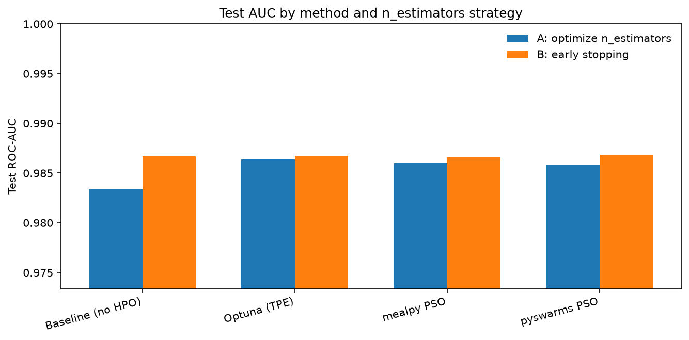
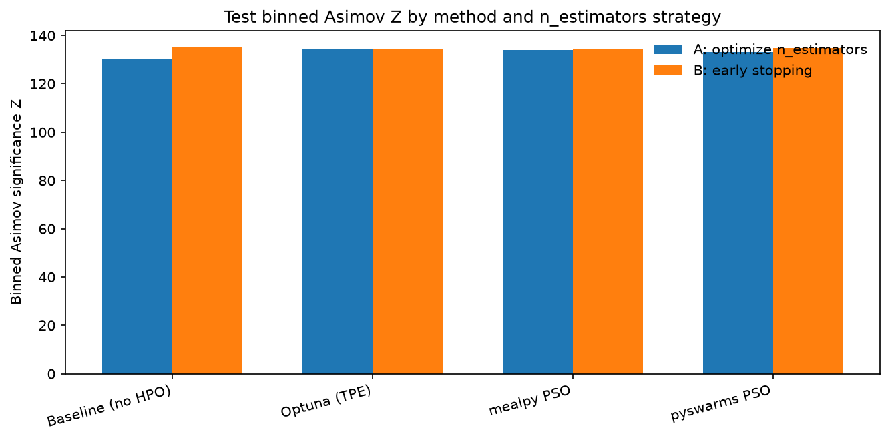
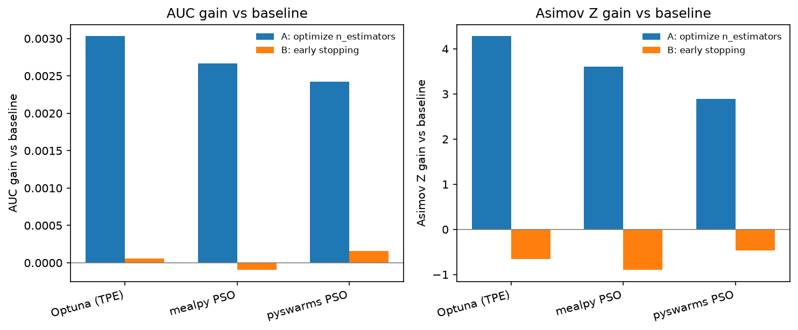
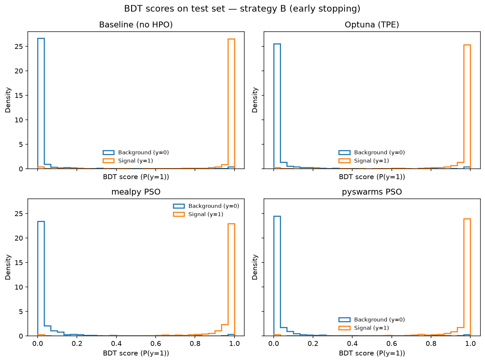
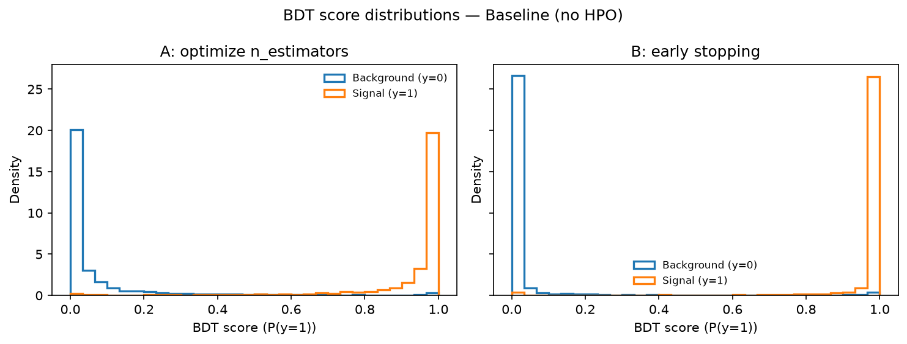
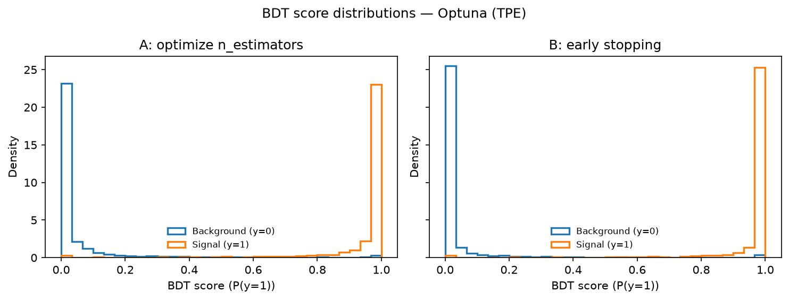
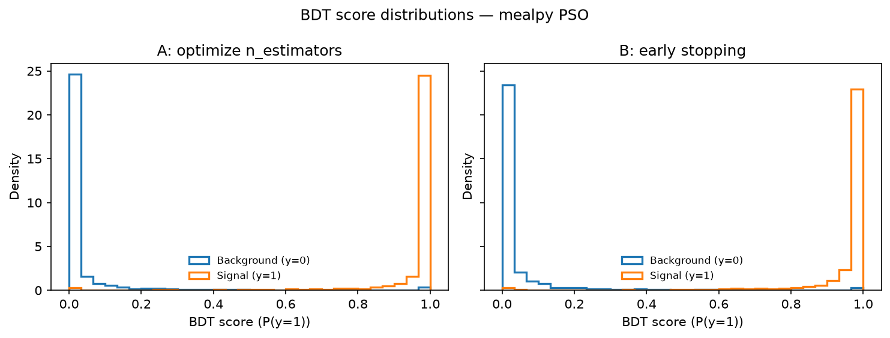
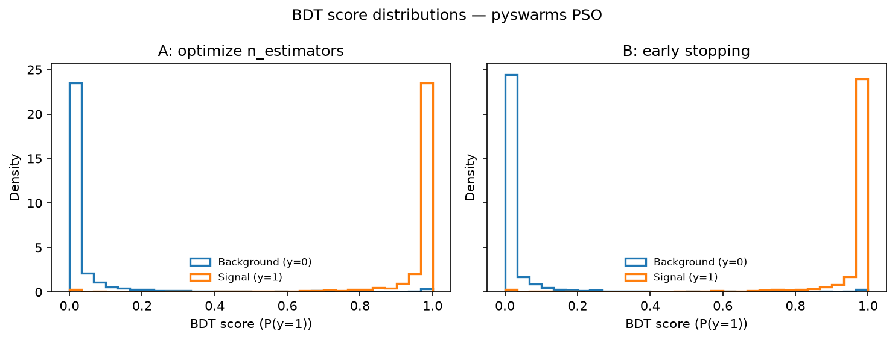

# Hyperparameter Optimization for XGBoost with Particle Swarm

This repository shows how to use **Particle Swarm Optimization (PSO)** for XGBoost hyperparameter tuning, and how PSO-based HPO compares to **Optuna** and a **no-HPO baseline**. The goal is to make PSO-based HPO easier to use with XGBoost by providing working examples, a clear train/validation/test protocol, and side-by-side metrics.

## Methods

| Method | Role |
|--------|------|
| **Baseline** | Default XGBoost hyperparameters (no HPO) |
| **Optuna** | Tree-structured Parzen Estimator (TPE) |
| **mealpy** | Classical PSO (`PSO.OriginalPSO`) |
| **pyswarms** | Global-best PSO (`GlobalBestPSO`) |

All HPO methods optimize the same continuous hyperparameters: `learning_rate`, `max_depth`, `subsample`, `colsample_bytree`, `min_child_weight`, `reg_lambda`. Fitness is **validation ROC-AUC**. The held-out **test set is never used** during training, early stopping, or HPO.

## Data protocol

Synthetic binary classification via `sklearn.datasets.make_classification` (30k samples, 50 features), split **60% / 20% / 20%** (stratified) into:

- **Train** — fit the model
- **Validation** — early stopping (strategy B) and HPO / Optuna objective
- **Test** — final evaluation only (BDT scores, AUC, binned Asimov significance)

## Two strategies for `n_estimators`

**A — Optimize `n_estimators` (no early stopping)**  
Include `n_estimators` in the search space and train for that many boosting rounds.

**B — Early stopping**  
Set `n_estimators` high (2000). Stop when validation AUC stops improving for 50 rounds. After HPO, take the best iteration from the best trial and use that tree count for the final model. Other hyperparameters are still optimized; `n_estimators` is *not* a search dimension.

## Metrics (test set only)

- **ROC-AUC**
- **Binned Asimov significance** — bin BDT scores (predicted \(P(y=1)\)), treat class 1 as signal and class 0 as background, then

  \[
  Z = \sqrt{\sum_i 2\big((s_i+b_i)\ln(1+s_i/b_i) - s_i\big)}
  \]

  with a small floor on \(b_i\) to avoid empty-bin singularities.

BDT score = XGBoost predicted probability of the positive class.

## How to run

```bash
python -m pip install -r requirements.txt
# On hosts whose driver is CUDA 12.x (not 13), use: pip install xgboost-cu12
python run_study.py
```

Outputs:

- `results/hpo_search.json` — best hyperparameters per method × strategy
- `results/test_metrics.csv` — test AUC / Asimov Z and gains vs baseline
- `results/summary.json` — winners
- `figures/` — BDT histograms and comparison plots

## Results

HPO budgets were kept comparable: Optuna 40 trials; mealpy 10 epochs × 8 particles; pyswarms 10 iterations × 8 particles.

### Test metrics

| Method | Strategy | n_estimators | Test AUC | Asimov Z | AUC gain vs baseline | Asimov gain vs baseline |
|--------|----------|-------------:|---------:|---------:|---------------------:|------------------------:|
| Baseline | A | 100 | 0.98337 | 130.31 | — | — |
| Optuna | A | 319 | 0.98640 | 134.59 | +0.00303 | +4.28 |
| mealpy | A | 421 | 0.98603 | 133.92 | +0.00267 | +3.61 |
| pyswarms | A | 417 | 0.98579 | 133.20 | +0.00243 | +2.89 |
| Baseline | B | 560 | 0.98667 | **135.11** | — | — |
| Optuna | B | 1630 | 0.98673 | 134.45 | +0.00006 | −0.66 |
| mealpy | B | 1102 | 0.98658 | 134.21 | −0.00010 | −0.90 |
| pyswarms | B | 382 | **0.98684** | 134.64 | +0.00016 | −0.47 |

### Who wins?

- **Best test AUC:** **pyswarms + early stopping (B)** — AUC **0.98684**
- **Best binned Asimov Z:** **baseline + early stopping (B)** — Z **135.11**  
  Under strategy B, early stopping alone on default XGBoost params is already strong. HPO methods are within ~0.0002 AUC of each other and of the baseline; Asimov Z is slightly higher for the baseline (binning is sensitive to score calibration, not only ranking).

Among HPO methods under strategy B (the stronger `n_estimators` protocol):

| Rank (AUC) | Method | Test AUC | Asimov Z |
|-----------:|--------|---------:|---------:|
| 1 | pyswarms | 0.98684 | 134.64 |
| 2 | Optuna | 0.98673 | 134.45 |
| 3 | mealpy | 0.98658 | 134.21 |

Under strategy A (search `n_estimators`, no early stopping), **Optuna** leads, then mealpy, then pyswarms — and all three clearly beat the fixed-`n_estimators=100` baseline.

### Strategy A vs B (per method)

For every method, **strategy B (early stopping) beats strategy A on test AUC**:

| Method | A AUC | B AUC | Prefer | A Asimov Z | B Asimov Z | Prefer (Asimov) |
|--------|------:|------:|--------|-----------:|-----------:|-----------------|
| Baseline | 0.98337 | 0.98667 | **B** | 130.31 | 135.11 | **B** |
| Optuna | 0.98640 | 0.98673 | **B** | 134.59 | 134.45 | A (tiny margin) |
| mealpy | 0.98603 | 0.98658 | **B** | 133.92 | 134.21 | **B** |
| pyswarms | 0.98579 | 0.98684 | **B** | 133.20 | 134.64 | **B** |

**Takeaway:** Prefer setting `n_estimators` high and using early stopping on the validation set, rather than searching `n_estimators` as a hyperparameter. PSO (mealpy / pyswarms) is competitive with Optuna on this problem; with early stopping, gains over a well-stopped baseline are small on this synthetic dataset.

### Metric comparison plots







### BDT score distributions

Overview (strategy B — early stopping), all methods:



Per method (left = A, right = B):









## Layout

```
run_study.py          # end-to-end study
src/
  config.py           # shared budgets / bounds
  data.py             # make_classification + train/val/test
  xgb_utils.py        # strategy A/B trainers
  hpo_methods.py      # baseline, Optuna, mealpy, pyswarms
  metrics.py          # AUC + binned Asimov Z
  evaluate.py         # test eval, plots, summary
figures/              # BDT histograms and comparison bars
results/              # hpo_search.json, test_metrics.csv, summary.json
```
